<picture>
  <source media="(prefers-reduced-motion: reduce)" srcset="assets/profile-banner-static.svg">
  
</picture>

  

## About Me

Hi, I'm **Phone Thant Kyaw**. Most people call me Phone.

- Fourth-year Computer Engineering student at Mae Fah Luang University, Chiang Rai, Thailand
- I build web and mobile apps, with a focus on AI and machine learning
- Teaching Assistant for programming (C#), networking, digital logic and data-analytics labs
- Joined FACE IT 2026 at Universitas Brawijaya, Indonesia: deep learning and AI for images
- Usually the one who connects the parts of a team project and works out why they don't fit
- Star Wars fan

## Core Tech Stack

#### Languages

       

#### Frameworks and Libraries

     

#### Databases, Cloud and Platforms

  

#### AI, Machine Learning and Data

     

#### Tools

   

Currently learning: AWS cloud services.

## Find Me

My [portfolio](https://zenzee7711.github.io/) has more project details, including
my road-risk computer-vision project and university work.

I'm looking for a co-op internship starting January 2027 in software or AI/ML.
You can reach me by [email](mailto:phonetk7711@gmail.com) or
[LinkedIn](https://www.linkedin.com/in/phone-thant-kyaw-8a8194216/).
