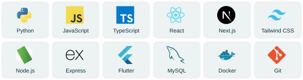

<picture>
  <source media="(prefers-reduced-motion: reduce)" srcset="assets/profile-banner-static.svg">
  
</picture>

  

## About Me

I'm Phone Thant Kyaw. Most people call me Phone. I'm a fourth-year Computer
Engineering student at Mae Fah Luang University in Chiang Rai, Thailand.

I work on web and mobile apps, and I'm interested in AI and machine learning.
I enjoy connecting the different parts of a project and figuring out why something
isn't working. In university projects, I often help coordinate the team as well.

I'm also a Teaching Assistant, supporting programming, networking, digital logic,
and data-analytics labs. Helping someone debug their code has taught me to explain
things clearly and check the basics first.

In September 2026, I joined FACE IT at Universitas Brawijaya in Indonesia, studying
deep learning and AI for images alongside international students. Outside those
interests, I'm a Star Wars fan.

## Lately

I've been building with Next.js, React, TypeScript, and Tailwind CSS. Two apps are
now online:

- **[Thai Stay](https://thai-stay-one.vercel.app/)** keeps my Thailand reporting and
  permitted-stay dates in one place. I made it for myself, friends, and juniors.
  [Code](https://github.com/Zenzee7711/thai_stay)
- **[WhatRWePlaying](https://whatrweplaying.vercel.app/)** helps find a PC game for
  a group and compare store prices. It includes natural-language search with an LLM.
  [Code](https://github.com/Zenzee7711/whatrweplaying)

I'm still learning AWS cloud services and exploring better ways to connect language
models to useful app features. These are personal projects that I'm continuing to improve.

## Tools I Use

| | |
| --- | --- |
| **Web** | TypeScript · JavaScript · React · Next.js · Tailwind CSS · HTML/CSS |
| **Backend & mobile** | Node.js · Express · REST APIs · MySQL · SQL · Flutter · Dart |
| **ML & data** | Python · LightGBM · scikit-learn · YOLO · OpenCV · PySpark · Kafka |
| **Development** | Git · Docker · Linux |
| **Currently learning** | AWS cloud services |

## Find Me

My [portfolio](https://zenzee7711.github.io/) has more project details, including
my road-risk computer-vision project and university work.

I'm looking for a co-op internship starting January 2027 in software or AI/ML.
You can reach me by [email](mailto:phonetk7711@gmail.com) or
[LinkedIn](https://www.linkedin.com/in/phone-thant-kyaw-8a8194216/).
